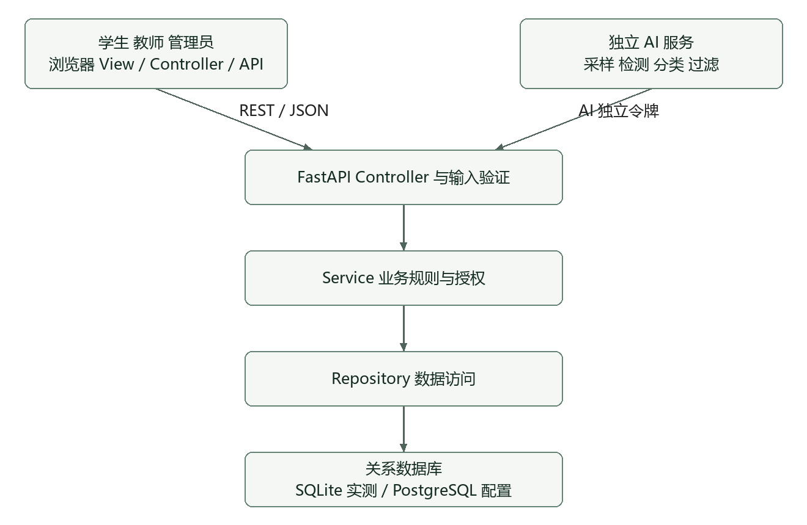
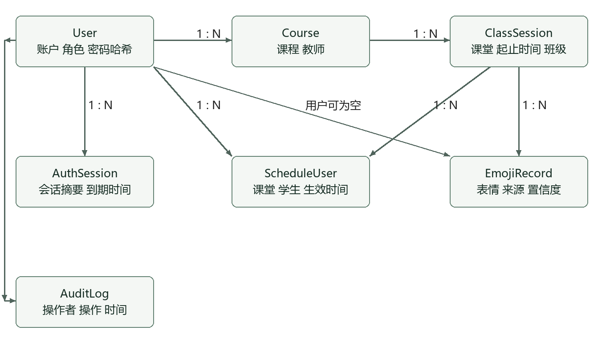
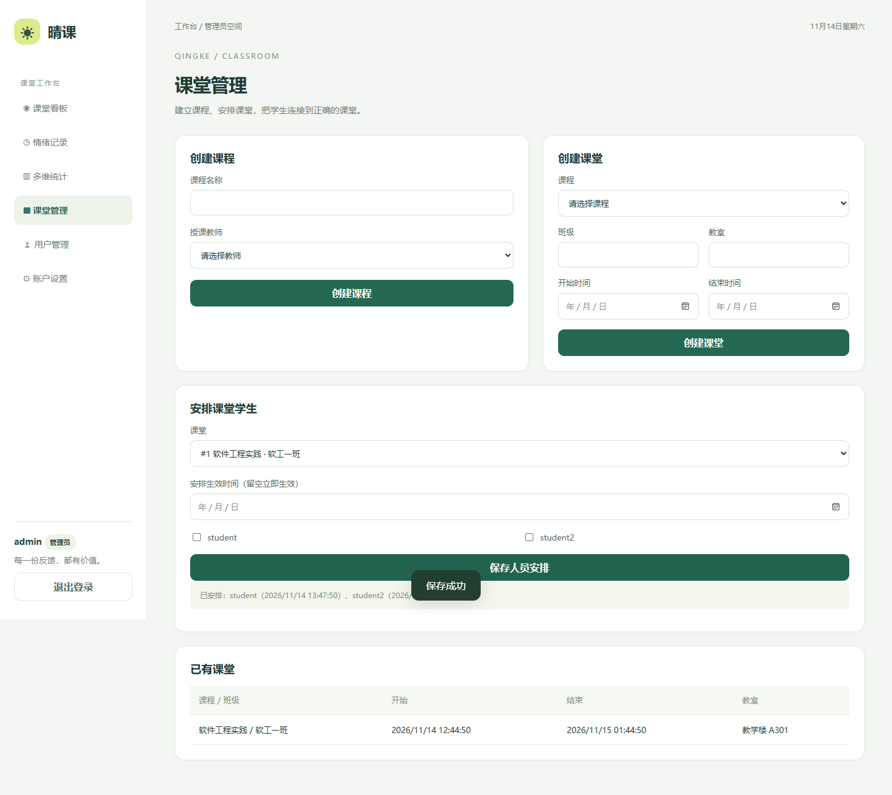
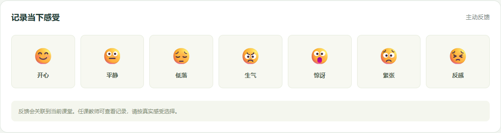
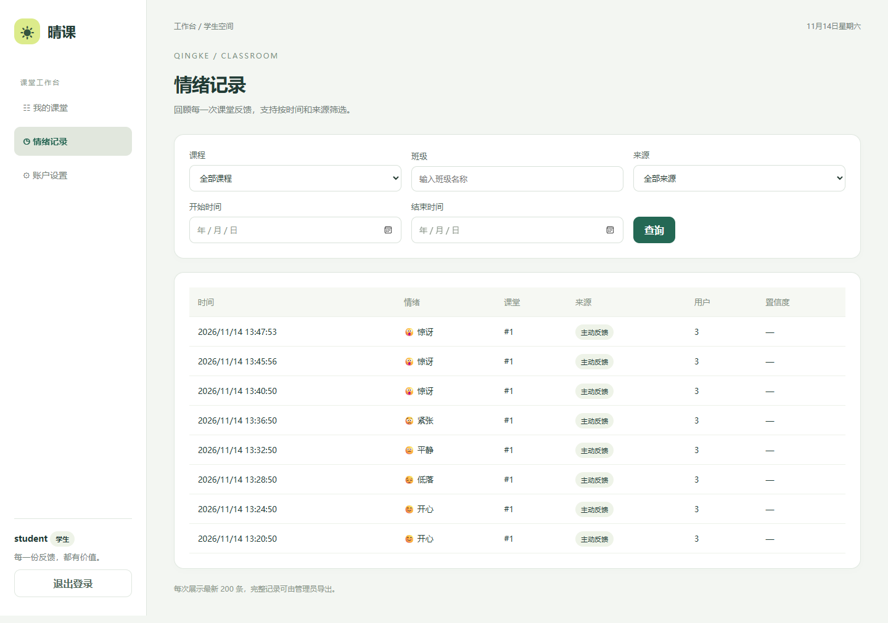
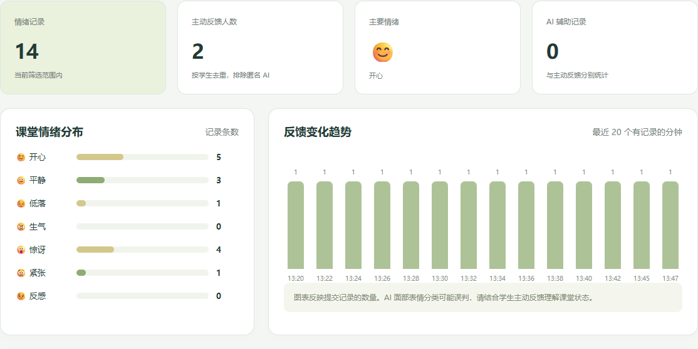
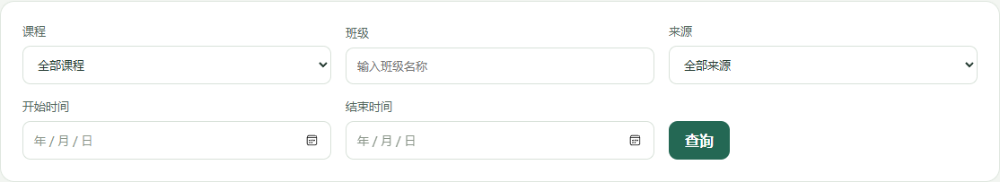
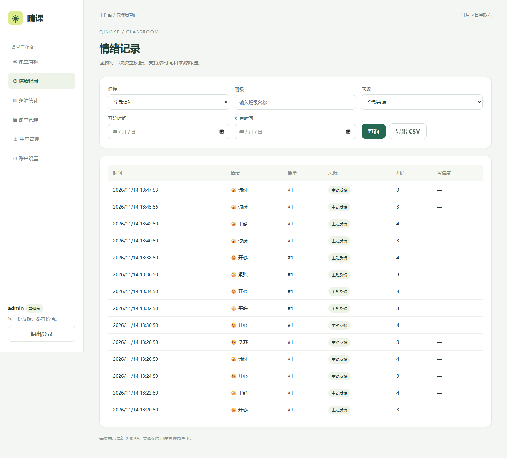
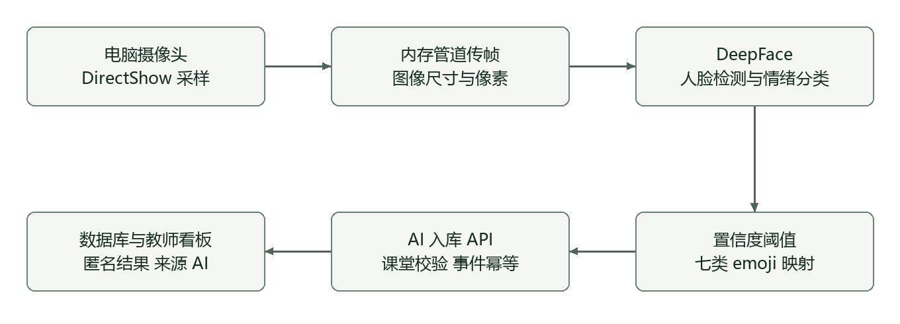

# 表情符号课堂情绪检查器系统

软件工程实践实验与结题报告

项目名称　晴课课堂情绪检查器

班级 ____________________

组号 ____________________

成员 ____________________

提交日期　2026 年 11 月 14 日

项目仓库　https://github.com/SHIN-ye/emoji-feedback

<!--page-->

## 摘要

本项目围绕课堂反馈的采集、管理与观察，实现了表情符号课堂情绪检查器系统。学生在有效课堂内选择表情提交反馈，教师查看所授课堂的历史记录、分布和变化趋势，管理员负责课程、课堂、人员安排、用户状态与数据导出。系统同时接入独立的视频表情推理服务，将电脑摄像头采样得到的表情分类结果转换为匿名 AI 记录，通过受保护的接口写入数据库。

系统采用浏览器客户端、FastAPI 分层后端、SQLAlchemy 数据访问和独立 Python AI 进程。本地实测使用 SQLite，提供 PostgreSQL 建表脚本及 Docker Compose 配置。客户端采用五秒轮询更新可见看板，后端统一执行角色和数据范围校验。密码加盐哈希、会话摘要存储、事件幂等和 CSV 公式转义共同支持数据与访问安全。

2026 年 11 月 14 日自动测试共 15 项通过，浏览器重新完成学生提交、教师查看与管理员导出的业务流程。2026 年 11 月 12 日电脑摄像头短时验收采样 8 帧，成功写入 1 条匿名 AI 记录，教师查询与看板核验通过。对 FER2013 公开测试分片的 7,178 张图像完成分类评测，七类准确率为 56.90%。目前缺少教室摄像头和真实课堂验证条件，多人远距离及持续运行效果需进一步验证。

关键词　课堂反馈　表情分类　角色权限　分层架构　软件测试

## 报告内容

本报告依次说明实验目标与需求、系统架构、数据库及接口设计、三类用户的实机操作、AI 实现与实测、软件测试、部署与局限性，最后汇总交付结果。图中业务界面均来自 2026 年 11 月 14 日运行的本地服务。截图使用独立演示库，预置记录为合成测试数据，操作过程中新增了实际提交的反馈。

<!--page-->

## 一 实验目标与需求分析

实验目标是完成从需求分析到系统实现、测试和交付的完整软件工程过程。课堂主动反馈与视频表情记录统一关联到课程和课堂会话，便于教师在明确的数据范围内观察课堂变化，并由管理员管理基础数据和导出记录。

### 角色与功能范围

|角色|核心操作|访问范围|
|---|---|---|
|学生|注册、登录、修改密码、选择表情、查询历史|本人记录与已安排课堂|
|教师|登录、课堂历史、实时看板、多维统计|本人授课课程及课堂|
|管理员|用户管理、课程课堂创建、人员安排、统计、CSV 导出|系统管理范围|
|AI 服务|采样、检测、分类、过滤、匿名提交|独立令牌认证的入库接口|

### 主要业务用例

管理员先创建课程并指定教师，再建立带有起止时间的课堂，将学生加入课堂名单。学生登录后只看到已安排的课堂，在课堂有效时间和安排生效后提交表情。服务端以当前会话确定用户，以服务器时间生成主动反馈记录。提交成功后，学生历史和教师看板能够查询到新增数据。

教师可以组合课程、班级、起止时间和来源筛选统计。管理员使用同类筛选条件查询数据并导出 CSV。AI 服务采样后携带课堂 ID、时间、置信度、设备标识与事件 ID 提交，服务端校验课堂时间、令牌、情绪枚举及阈值。

### 约束与异常处理

未安排学生、尚未生效的安排和已结束课堂均不能接收主动反馈。教师查询先限定课程归属，再应用筛选条件。无数据时显示空状态，统计数量为零。重复事件使用同一 ID 保持幂等，内容冲突返回错误。界面显示服务端错误提示，避免将失败操作误认为成功。

<!--page-->

## 二 总体架构与修改版 MVC

浏览器界面覆盖学生、教师和管理员入口，独立 AI 进程作为另一个客户端，通过 REST/JSON 与后端交互。后端将 HTTP 请求、业务规则和数据访问分开组织，数据库负责关系与约束。应用与 AI 环境分别安装依赖，减少模型依赖对业务服务的影响。



|层次|主要文件|职责|
|---|---|---|
|浏览器 View|web/index.html、style.css、app.js 的视图函数|页面结构、表格、图表和状态展示|
|浏览器 Controller|web/app.js|路由、事件、表单提交与刷新|
|浏览器数据访问|web/api.js|令牌状态、HTTP 请求、导出|
|后端 Controller|backend/main.py、schemas.py|接口路由、输入验证、响应格式|
|Service|backend/services.py|权限、课堂规则、统计和业务事务|
|Repository|backend/repository.py|参数化查询和数据范围过滤|
|数据模型|backend/models.py|实体字段、外键及数据库约束|
|独立 AI|ai/worker.py、camera_pipe.py|采样、推理、结果转换与提交|

修改版 MVC 的核心是将业务规则从页面事件和路由处理中抽离。前端视图与控制函数目前位于同一模块内，通过函数职责区分；后端采用明确的 Service 与 Repository 文件分层。页面切换和请求返回使用版本检查，防止旧响应覆盖新页面或进入另一账户的界面状态。

<!--page-->

## 三 数据模型与完整性约束

系统使用关系型实体表达用户、教学组织和反馈记录。课程关联任课教师，课堂关联课程，学生通过安排表加入课堂。主动反馈关联学生，AI 记录允许用户为空。认证会话与审计日志作为扩展实体，为登录管理和关键操作追踪提供支持。



|实体|关键字段|约束或用途|
|---|---|---|
|User|username、password_hash、role、email、status|用户名唯一，角色和状态枚举|
|Course|name、teacher_id|教师外键|
|ClassSession|course_id、class_name、room、start_time、end_time|结束时间晚于开始时间|
|ScheduleUser|session_id、user_id、scheduled_at|课堂与学生组合唯一|
|EmojiRecord|session_id、user_id、emoji、timestamp、source、confidence、device_id、event_id|七类情绪枚举，AI 置信度有效，事件 ID 唯一|
|AuthSession|token_hash、user_id、expires_at|仅保存会话令牌摘要|
|AuditLog|user_id、action、timestamp|关键操作审计|

时间统一按 UTC 存储，接口使用带时区的时间格式，页面转换为本地时间。统计中的参与人数仅对主动反馈用户去重，匿名 AI 数据计入记录条数。数据库表结构与 PostgreSQL 建表脚本随项目文档提交。

<!--page-->

## 四 接口设计与安全控制

后端提供统一 REST API。成功响应包含 code 和 data，失败响应包含 HTTP 状态对应的 code 与 message。业务接口在服务端验证身份，普通账户使用 Bearer 会话令牌，AI 服务使用独立的 X-AI-Token。交互式接口文档入口为 /docs，机器可读契约为 /openapi.json。

|接口类别|主要路径|调用者|
|---|---|---|
|认证|POST /api/auth/register、/login、/logout|用户|
|改密|PUT /api/auth/password|已登录用户|
|用户管理|GET /api/admin/users、PATCH /api/admin/users/{id}|管理员|
|课堂安排|POST /api/admin/sessions/{id}/schedule|管理员|
|反馈|POST /api/emoji、GET /api/emoji/history|学生提交，按角色查询|
|看板|GET /api/admin/dashboard/realtime|教师、管理员|
|多维统计|GET /api/admin/statistics|教师、管理员|
|AI 入库|POST /api/ai/emoji-results|独立 AI 服务|
|导出|GET /api/admin/emoji/export|管理员|

### 身份与权限

密码使用随机盐和 PBKDF2-HMAC-SHA256，迭代次数为 600,000。会话令牌为高熵随机值，数据库存储 SHA-256 摘要。修改密码撤销原有会话，停用用户后拒绝继续访问。教师和管理员注册需要分别配置的邀请码。

### 数据与输出保护

Repository 使用 SQLAlchemy 参数化查询。用户文本在界面输出时进行转义，CSV 对可能触发表格公式的前缀进行处理。服务端对枚举、置信度、课堂归属和时间范围执行校验。权限测试同时检查学生访问管理员接口、教师访问其他课程和账户停用后的会话行为。

接口文档、数据库脚本和部署参数分别保存在 docs/openapi.json、docs/schema-postgresql.sql 与 .env.example 中。

<!--page-->

## 五 管理员课堂组织与人员安排

管理员通过课堂管理界面创建课程与课堂。课程需指定有效教师，课堂配置班级、教室和起止时间。系统将时间有效性作为提交反馈的业务条件，避免不同课堂的记录混合。人员安排支持设置未来生效时间，也可以留空立即生效。



本次操作选择“软件工程实践·软工一班”，保存 student 和 student2 的名单安排，页面显示“保存成功”和已安排成员。安排采用增量添加或更新时间，同一学生在同一课堂仅保留一条关联。用户管理界面还提供账户启用与停用操作，停用结果由服务端强制执行。

<!--page-->

## 六 学生主动反馈与个人历史

学生登录后选择已安排课堂，在“记录当下感受”区域提交开心、平静、低落、生气、惊讶、紧张或反感。界面提交按钮在请求期间禁用，避免重复点击。服务器根据当前会话写入用户 ID、课堂 ID、表情类型和时间，来源记为 MANUAL。



本次浏览器实际选择惊讶表情，界面返回“已记录，谢谢你的反馈”。随后进入个人情绪历史，查看到新增记录。报告截图使用的数据库包含预置演示历史；两轮界面检查各新增一条惊讶记录，教师汇总为 14 条记录、2 名主动反馈学生。



学生查询由后端限定为本人记录，不能通过修改查询条件读取其他学生数据。账户设置提供修改密码功能，成功后需要重新登录，旧会话无法继续使用。

<!--page-->

## 七 教师实时看板与多维统计

教师进入所授课堂后，可查看情绪记录总数、主动反馈人数、主要情绪和 AI 辅助记录数。分布图按表情类别汇总，趋势图按分钟展示反馈数量。页面可见时每五秒轮询一次，显示更新时间；离开页面后停止该页面的刷新任务。



教师多维统计支持课程、班级、来源及起止时间组合查询。本次以“软工一班”和主动反馈来源进行实际查询，统计返回对应记录。时间在提交查询时转换为标准格式，后端在教师课程范围内执行筛选。



主动反馈人数采用用户去重计数。连续摄像头采样可能多次记录同一张人脸，因此 AI 数量仅用于反映采样记录，不能直接解释为学生人数或学生的真实心理状态。

<!--page-->

## 八 管理员查询与 CSV 导出

管理员在情绪记录页面查看当前筛选结果，再点击“导出 CSV”。导出接口使用相同筛选条件并执行管理员权限校验，返回带 UTF-8 BOM 的 CSV，方便常见表格软件显示中文。页面仅展示最近 200 条记录，导出覆盖筛选范围内的全部记录。



本次浏览器操作实际下载了 CSV，文件中包含新增的 surprise 记录。导出字段为 id、user_id、session_id、emoji、timestamp、source、confidence、device_id。主动反馈的置信度为空，匿名 AI 的用户字段为空，可通过 source 区分两种来源。

CSV 防护测试构造以等号开头的设备标识，核对导出值添加安全前缀；教师账号调用管理员导出接口返回权限错误。导出功能因此同时验证了数据内容、格式与访问控制。

<!--page-->

## 九 AI 推理流程与集成实现

AI 服务读取指定摄像头或本地视频，按可配置间隔采样，执行人脸检测和七类表情分类。模型返回类别分数后，程序选择最高分情绪，将百分比分数转换为 0 到 1 的置信度，仅提交达到阈值且检测到有效人脸的结果。默认采样间隔为 3 秒，默认阈值为 0.60。



### 本机设备接入

本机 AI 虚拟环境直接打开摄像头时曾返回拒绝访问。最终使用独立 Python 3.15.2 的 DirectShow 采集，通过本机二进制管道传递图像尺寸和帧数据，由 Python 3.12 环境中的 DeepFace 完成推理。所有帧在内存中处理。中文路径下 Haar 分类器读取失败通过读取 XML 内容并在内存中加载解决。

### 入库与容错

AI 不直接写数据库，使用独立令牌调用入库接口。每次事件携带课堂 ID、时间、类别、置信度、设备标识和唯一 event_id。服务端再次校验阈值和课堂时间，匿名记录 user_id 为空。网络异常和服务端暂时错误进行有限重试，重试保留事件 ID，避免重复写入。

本机采集管道关闭时进程退出，需要重新启动，持续运行与硬件故障恢复仍属于后续验证范围。

<!--page-->

## 十 电脑摄像头实测结果

2026 年 11 月 12 日开展本机内置摄像头短时验收。验收脚本启动隔离的本地 HTTP 服务和数据库，创建有效课堂，运行真实推理进程，再以教师身份读取历史与实时看板。判定通过需要进程正常退出、至少产生一条 AI 记录且教师看板 AI 计数与记录数一致。

|检查项|实际结果|
|---|---|
|采样帧数|8|
|成功入库数|1|
|入库 HTTP 状态|200 OK|
|分类结果|fear，置信度 0.8381988525|
|记录来源与用户|AI，user_id 为 null|
|教师历史记录数|1|
|教师看板 AI 计数|1|
|进程退出码与验收结果|0，passed 为 true|

日志中记录了接口返回、accepted=True、记录 ID，以及 sampled_frames=8、accepted_results=1 的结束汇总。其他采样帧记录了未得到有效人脸的情况。该测试证实电脑摄像头输入能够经过模型推理、规则过滤和服务接口进入数据库。

### 证据与可复核性

原始结果副本保存在 docs/demo/evidence/camera-result.json，日志节选保存在 camera-worker-excerpt.log。验收代码为 scripts/verify_ai_camera.py，设备管道为 ai/camera_pipe.py，部署手册给出可复现命令。系统默认不保存原始人脸图像和视频，因此本次保留运行日志、结构化记录和接口核验结果。

目前未配备安装在教室内的摄像头，也缺少真实课堂部署和验证条件。本次成功结果适用于电脑摄像头短时链路，不包含真实课堂多人远距离检测、遮挡适应性或长时间运行保证。

<!--page-->

## 十一 FER2013 分类模型评测

为评估已接入模型的分类输出，使用 Jeneral/fer-2013 公开 test 分片中的 7,178 张图像。评测输入为已裁剪人脸，转为 48×48 灰度图像并归一化，按标签名称对齐数据集与模型的类别顺序。批量推理后根据最大输出分数选择类别，累计混淆矩阵、准确率与各类召回率。[1]

|指标|结果|
|---|---|
|样本数与正确数|7,178 张，4,084 张正确|
|七类 Top-1 准确率|56.90%|
|七类平均召回率|53.99%|
|阈值 0.60 时保留样本|6,043 张|
|阈值覆盖率|84.19%|
|保留样本准确率|61.84%，3,737 张正确|

|类别|样本数|召回率|
|---|---|---|
|angry 生气|958|43.95%|
|disgust 反感|111|45.05%|
|fear 紧张|1,024|41.11%|
|happy 开心|1,774|77.51%|
|sad 低落|1,247|40.82%|
|surprise 惊讶|831|71.72%|
|neutral 平静|1,233|57.75%|

脚本为 scripts/evaluate_fer2013.py，结果文件为 docs/demo/evidence/fer2013-result.json，保存了 DeepFace 0.0.93 版本信息、完整混淆矩阵和数据 SHA-256。数据校验值已再次与本机测试文件核对一致。

开心和惊讶的召回率较高，悲伤、恐惧等类别存在较多混淆。提高置信度筛选后，保留样本准确率上升，但覆盖率下降。模型置信度尚未在课堂数据上校准。预训练模型使用过 FER2013，本次属于同数据集基准复核，独立课堂泛化效果仍需验证。[2]

<!--page-->

## 十二 软件测试与问题处理

2026 年 11 月 14 日在项目主环境运行 pytest，15 项测试全部通过，耗时 10.18 秒。测试包括业务规则、角色权限、认证状态、统计与导出、AI 映射及重试、帧结果入库与教师看板核对。完整用例表及对应测试函数见《测试报告与测试用例》。

|测试范围|验证重点|结果|
|---|---|---|
|账户与安全|弱密码、角色提权、改密旧会话、停用账户、SQL 注入文本|通过|
|课堂规则|名单安排、课堂有效期、未来生效时间、枚举校验|通过|
|数据范围|学生本人数据、教师所授课程、管理员接口|通过|
|统计与 CSV|计数、筛选、参与人数、公式前缀转义|通过|
|AI 协议|独立令牌、阈值、幂等、冲突事件、有限重试|通过|
|AI 集成|七类输出经过实际路由和数据库，无脸不入库|通过|

### 浏览器端到端测试

本次重新运行本地服务，完成管理员保存名单、学生提交、教师看板与筛选、管理员导出的操作。下载的 CSV 包含新增记录，浏览器未捕获脚本异常。报告中的运行截图均来自这一流程。接口文档 JSON 可访问；交互式 Swagger 页依赖外部资源，离线时可以查看随包提交的 OpenAPI 文件。

### 已处理的问题

早期浏览器测试发现旧请求返回覆盖新页面，以及管理员保存后的响应进入学生账户界面的状态污染。通过路由版本与请求序号检查丢弃过时响应，并在页面退出时清除轮询。非法中文邀请码曾触发服务器异常，修复后作为权限错误处理。AI 环境中的摄像头访问和中文路径分类器问题已通过独立采集与内存加载解决。

第三方 TestClient 存在一条依赖弃用提示，当前测试正常执行。PostgreSQL 容器运行、并发负载、独立受试者可用性研究及硬件断线恢复尚未完成验收。

<!--page-->

## 十三 部署运行与交付

业务服务本机使用 Python 3.15.2。建立 .venv 并安装 requirements-lock.txt 后，执行 scripts.seed --demo 生成演示账号和随机密码，再启动 FastAPI。演示课堂默认有效 12 小时，过期后需要管理员新建有效课堂和名单安排。

```text
python -m venv .venv
.\.venv\Scripts\python.exe -m pip install -r requirements-lock.txt
.\.venv\Scripts\python.exe -m scripts.seed --demo
.\.venv\Scripts\python.exe -m uvicorn backend.main:app --port 8000
```

浏览器访问 http://127.0.0.1:8000。直接调用 Python 可避免 PowerShell 对 ps1 的执行策略限制。教师、管理员邀请码和 AI 令牌通过环境变量配置，本地服务不自动读取 .env。AI 单独使用 Python 3.12 环境，依赖与启动命令见部署手册。

提供的 Docker Compose 包含应用与 PostgreSQL 服务，数据库通过命名卷持久化。当前该部署路径仅提供配置，尚未完成容器运行验证。本地实测使用 SQLite，源码包不携带运行数据库与私密配置，新环境通过初始化命令创建数据。

### 线上提交材料

|目录|内容|
|---|---|
|01 源码|后端、浏览器端、AI、测试、初始化脚本、依赖、README、SQL、OpenAPI 和 Docker 配置|
|02 演示视频|约 6 分 33 秒 MP4，含中文说明和 AI 验证范围|
|03 项目文档|需求设计、计划、测试用例、部署手册、验证证据、截图及成员贡献表|
|04 结题报告|本实验与结题报告的 Word 和 PDF 版本|

提交目录检查后，按指导书命名为 SE-EmojiChecker-组号-最终提交.zip。源码仓库地址见封面，完整提交历史可在线查看。

<!--page-->

## 十四 局限性与实验总结

### AI 模型与环境局限

面部表情和内心情绪并非一一对应。相同表情在不同文化、个体和课堂情境中可能具有不同含义。模型输出用于辅助观察课堂反馈，不能单凭类别判断学习理解程度或心理健康。光照、姿态、遮挡、分辨率和多人画面都会影响检测与分类。

本机摄像头已完成短时采集、推理及入库验证，公开数据集评测也已形成可复核结果。真实教室摄像头、多人与远距离拍摄、持续运行及故障恢复需要独立验证。FER2013 评测使用已裁剪图像，预训练模型使用过该数据集，当前分数不能直接代表真实课堂准确率。

### 工程实现总结

本项目完成了从课堂组织、学生主动反馈到教师观察与管理员导出的业务流程，并通过统一接口接入独立 AI 服务。后端分层使权限与业务规则集中维护，数据库约束补充业务校验，前端版本检查避免异步响应污染。AI 事件 ID 将重试与幂等结合，来源字段帮助区分主动反馈和模型采样。

测试过程表明，仅检查页面是否出现数据不足以判断完整功能。需要同时核对授权范围、课堂时间、入库记录与统计口径。摄像头测试与数据集评测分别验证了设备接入链路和分类输出，运行日志、结构化结果和脚本形成了可复查的证据。

后续工作包括真实课堂采集验证、PostgreSQL 部署实测、长时运行与并发测试，以及根据课堂样本进行模型效果分析。当前版本已形成源码、演示视频、项目文档和实验与结题报告，能够用于本课程的功能演示与材料审查。

## 参考资料

[1] Jeneral. FER2013 数据集 test 分片. https://huggingface.co/datasets/Jeneral/fer-2013 （访问日期 2026 年 11 月 14 日）。

[2] NXP. DeepFace Emotion 模型说明. https://github.com/NXP/eiq-model-zoo/blob/main/tasks/vision/classification/deepface-emotion/README.md （访问日期 2026 年 11 月 14 日）。

[3] 《表情符号课堂情绪检查器系统》实验指导书，软件工程实践课程材料。
