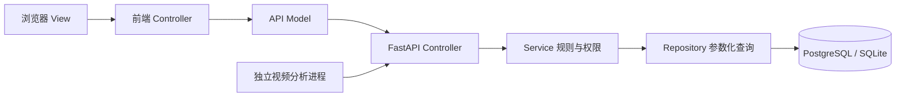
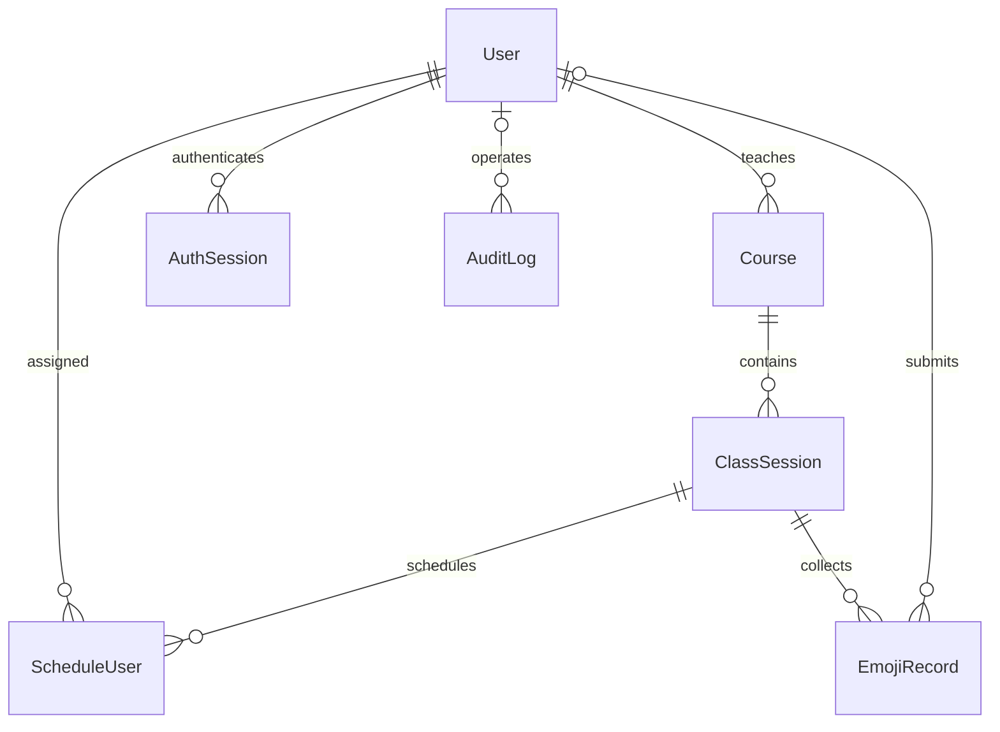

# 需求规格与概要设计

版本 2.0，更新日期 2026 年 11 月 14 日。系统以浏览器客户端和独立视频推理服务覆盖三类用户与两种反馈来源，当前采用 SQLite 完成本地验证，提供 PostgreSQL 部署配置。运行界面和实现过程见《实验与结题报告》。

## 需求追踪
|编号|需求|实现位置|验证|
|FR01|注册登录改密注销|security/services/main|tests/test_api.py|
|FR02|学生提交与个人历史|services.record、repository.records|test_manual_flow_and_scoped_history|
|FR03|教师所授课堂范围|repository.sessions/records|test_manual_flow_and_scoped_history|
|FR04|用户、课程、课堂管理|admin 路由|接口测试与浏览器演示|
|FR05|课堂人员及生效时间|ScheduleUser|test_invalid_sessions_and_future_schedule|
|FR06|实时看板和多维统计|statistics + 五秒刷新|接口统计及浏览器检查|
|FR07|CSV 导出防注入|services.export|CSV 专项测试|
|FR08|AI 情绪与阈值|ai.worker + ai 路由|test_ai + 接口测试|
|NFR01|授权及密码保护|security + scope|安全测试|
|NFR02|原始视频不落库|AI 只提交结果|代码检查及本机摄像头实测|

## 系统结构

## 实体关系

## 业务规则
注册默认学生；教师和管理员须输入对应邀请码。邀请码配置为空时，该角色注册关闭。部署者通过命令初始化首位管理员。学生仅见被安排的课堂；教师仅见自己授课课程及课堂；管理员查看全部。学生的提交时间由服务器决定，且必须在课堂起止时间和安排生效时间范围内。改密需要旧密码，并撤销所有登录会话。
AI 默认匿名，置信度 [0,1]，服务端阈值默认 0.6；事件时间必须属于课堂，且不得明显超前。event_id 去重；相同事件不同内容返回冲突。AI 不提供身份识别。
多维统计支持课程、班级、起止时间、来源，用户权限范围先过滤再统计。参与人数仅计算手动记录中的去重学生；记录条数不能冒充人数。趋势按 UTC 分钟汇总，前端本地化显示时间。无数据时总数为 0，各情绪计数为 0。

## 访问矩阵
|操作|学生|教师|管理员|AI 服务|
|---|---|---|---|---|
|手动提交|已安排有效课堂|否|否|否|
|历史|本人|所授课堂|全部|否|
|实时看板/统计|本人基础统计|所授课堂|全部|否|
|安排、管理、导出|否|否|是|否|
|AI 入库|否|否|否|独立令牌|

## 非功能与部署
教学规模目标为单课堂约 50 人、看板 5 秒刷新；这只是设计目标，未开展负载测试前不声明性能达标。后端无原始媒体上传接口。业务页面无外部 CDN 依赖，Swagger 文档页面需加载外部资源，用户文本使用转义或 textContent。部署使用环境变量传递密钥；本地仅绑定 127.0.0.1；对外部署须由反向代理配置 HTTPS。数据库结构初始化只用于新部署，后续生产变更需补充迁移脚本。

## 主要用例说明

### UC01 账户注册与登录
学生使用用户名和符合强度要求的密码注册。教师和管理员还需对应邀请码。登录成功后服务端建立会话，前端进入角色工作台。用户名重复、邀请码错误或密码不符合约束时显示错误信息。改密验证原密码后撤销旧会话。

### UC02 组织课堂与安排学生
管理员已登录，系统已有教师和学生账户。管理员创建课程、指定教师、填写班级与课堂起止时间，再选择课堂和学生保存安排。安排生效时间留空则立即生效。非法时间或非学生账户被拒绝。同课堂同学生采用唯一约束，重复安排更新生效时间。

### UC03 提交课堂反馈
学生已被安排在有效课堂中。选择表情后服务端校验学生身份、课堂有效期和安排生效时间，写入 MANUAL 记录并返回结果。界面刷新个人统计与历史。未安排、已结束或尚未开始的课堂拒绝提交。

### UC04 教师查看与筛选
教师登录后选择本人所授课堂，读取实时看板与历史。统计筛选条件包括课程、班级、开始时间、结束时间和来源。数据范围校验先于筛选执行。无结果显示空状态，跨课程请求被拒绝或返回范围内空结果。

### UC05 管理员导出
管理员在历史页面设置筛选并查询，然后导出同条件记录。后端逐项写出 CSV 字段，对公式前缀进行防护。教师与学生调用管理员导出接口返回权限错误。

### UC06 AI 采样与入库
AI 服务持有独立令牌和有效课堂 ID。采集帧后检测人脸并调用预训练情绪模型，对类别、分数与阈值检查后提交结果。服务端校验课堂时间、来源字段与事件 ID，创建匿名记录。同一事件重试返回原结果，内容冲突返回 409。无人脸或低于阈值不写入。

## 数据字典摘要

|实体|关键字段|类型或约束|
|---|---|---|
|User|id、username、password_hash、role、email、status、created_at|整型主键；用户名唯一；角色和状态枚举|
|Course|id、name、teacher_id|教师外键引用 users.id|
|ClassSession|id、course_id、class_name、room、start_time、end_time|课程外键；结束晚于开始|
|ScheduleUser|id、session_id、user_id、scheduled_at|课堂与用户外键；组合唯一|
|EmojiRecord|id、user_id、session_id、emoji、timestamp、source、confidence、device_id、event_id|用户可空；情绪和来源枚举；AI 置信度为 0 到 1；事件 ID 唯一|
|AuthSession|token_hash、user_id、expires_at|令牌摘要主键；用户外键|
|AuditLog|id、user_id、action、timestamp|操作人可空；保存关键操作及时间|

字段长度、索引与精确建表语句见 schema-postgresql.sql；接口输入输出字段见 openapi.json。数据库关系图为 images/er.png，整体分层图为 images/architecture.png。

## 接口错误与状态变化

401 表示认证缺失或失效；403 表示权限或课堂安排限制；400 表示时间范围等业务条件不满足；409 表示唯一性或重复事件内容冲突；422 表示输入字段不符合模型。成功响应统一包含 code 和 data，失败响应包含 code 与 message。

前端切换页面递增路由版本，请求返回时核对版本。历史和统计查询另有请求序号，避免慢请求覆盖新条件结果。离开看板后清除轮询，页面隐藏时跳过刷新。改密、注销和账户停用均会使旧会话失效。

## AI 验证与范围

已完成电脑摄像头短时采样入库及 FER2013 分类评测，证据见 demo/evidence。尚缺真实教室摄像头和课堂验证条件。当前本机 DirectShow 管道在采集中断后退出，硬件断线恢复未完成验收。网络请求具有有限重试和事件幂等保护。当前分类模型输出仅作为课堂反馈辅助信息。
