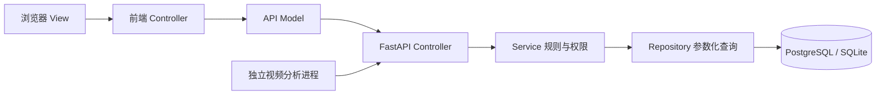
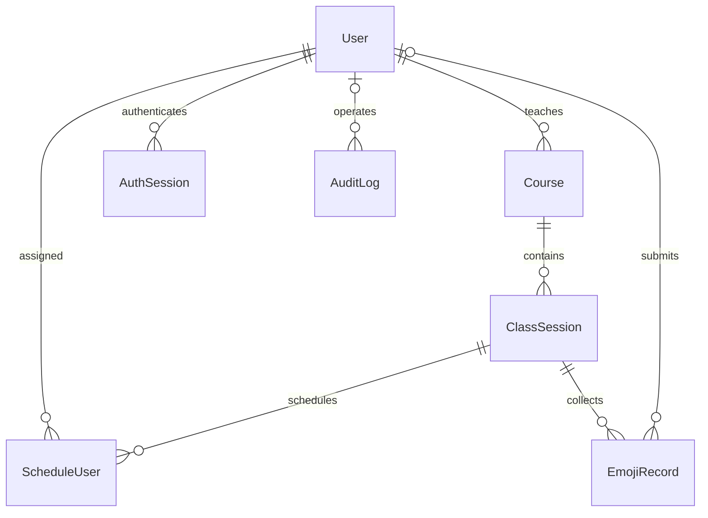

# 需求规格与概要设计

## 需求追踪
|编号|需求|实现位置|验证|
|FR01|注册登录改密注销|security/services/main|test_registration、test_password|
|FR02|学生提交与个人历史|services.record、repository.records|test_manual_flow|
|FR03|教师所授课堂范围|repository.sessions/records|test_manual_flow|
|FR04|用户、课程、课堂管理|admin 路由|接口测试与浏览器演示|
|FR05|课堂人员及生效时间|ScheduleUser|test_invalid_sessions|
|FR06|实时看板和多维统计|statistics + 五秒刷新|接口统计及浏览器检查|
|FR07|CSV 导出防注入|services.export|CSV 专项测试|
|FR08|AI 情绪与阈值|ai.worker + ai 路由|test_ai + 接口测试|
|NFR01|授权及密码保护|security + scope|安全测试|
|NFR02|原始视频不落库|AI 只提交结果|代码检查，现场验收|

## 系统结构

## 实体关系

## 业务规则
注册默认学生；教师和管理员须输入对应邀请码。邀请码配置为空时，该角色注册关闭。部署者通过命令初始化首位管理员。学生仅见被安排的课堂；教师仅见自己授课课程及课堂；管理员查看全部。学生的提交时间由服务器决定，且必须在课堂起止时间和安排生效时间范围内。改密需要旧密码，并撤销所有登录会话。
AI 默认匿名，置信度 [0,1]，服务端阈值默认 0.6；事件时间必须属于课堂，且不得明显超前。event_id 去重；相同事件不同内容返回冲突。AI 不提供身份识别。
多维统计支持课程、班级、起止时间、来源，用户权限范围先过滤再统计。参与人数仅计算手动记录中的去重学生；记录条数不能冒充人数。趋势按 UTC 分钟汇总，前端本地化显示时间。无数据时总数为 0，各情绪计数为 0。

## 访问矩阵
|操作|学生|教师|管理员|AI 服务|
|---|---|---|---|---|
|手动提交|已安排有效课堂|否|否|否|
|历史|本人|所授课堂|全部|否|
|实时看板/统计|本人基础统计|所授课堂|全部|否|
|安排、管理、导出|否|否|是|否|
|AI 入库|否|否|否|独立令牌|

## 非功能与部署
教学规模目标为单课堂约 50 人、看板 5 秒刷新；这只是设计目标，未开展负载测试前不声明性能达标。后端无原始媒体上传接口。页面无外部 CDN 依赖，用户文本使用转义或 textContent。部署使用环境变量传递密钥；本地仅绑定 127.0.0.1；对外部署须由反向代理配置 HTTPS。数据库结构初始化只用于新部署，后续生产变更需补充迁移脚本。
